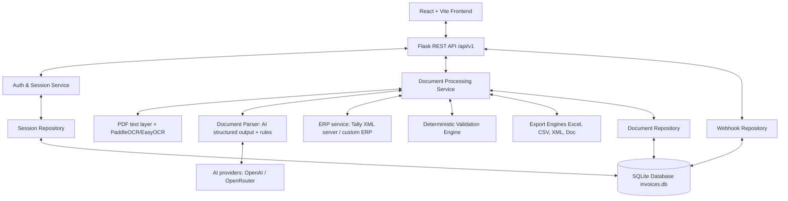

# System Architecture

The AI-Powered Invoice & ERP Automation Platform is built using a decoupled client-server architecture: local text extraction (PDF text layer, then local OCR), server-side AI extraction (OpenAI or OpenRouter) with a rule-based fallback, deterministic validation, human review and durable SQLite persistence.

## 1. Overview



---

## 2. Backend Modules & Layering

1. **API Layer (`backend/app/api/v1/`)**: Exposes REST endpoints, WhatsApp Webhooks with Meta HMAC-SHA256 verification, ERP synchronization, and file upload endpoints.
2. **Authentication & Security Layer (`backend/app/auth/`)**: Cookie-based server sessions, CSRF token validation, constant-time credential verification, login rate limiting (Flask-Limiter), and CRLF-safe authentication logging.
3. **Database Layer (`backend/app/db/`)**:
   - Connection factory with WAL mode pragmas (`connection.py`).
   - Declarative schema definitions (`schema.sql`).
   - Server-side session revocation store (`session_repository.py`).
   - Webhook idempotency and audit store (`webhook_repository.py`).
   - Safe, idempotent JSON-to-SQLite migration utility (`migrate_json_to_sqlite.py`).
4. **Service Layer (`backend/app/services/`)**: Orchestrates document processing, OCR extraction, deterministic validation, analytics aggregation, and ERP dispatch.
5. **OCR Engine (`backend/app/ocr/`)**: Uses the embedded PDF text layer when a page has one; otherwise renders the page (PyMuPDF) and runs local OCR (PaddleOCR first, EasyOCR as backup, selectable with `OCR_ENGINES`). Engines are loaded once, guarded by a lock, and reported through `/api/v1/system/status`.
6. **AI Providers (`backend/app/ai/`)**: `OpenAIProvider` (primary; Structured Outputs with a strict JSON schema, vision input) and `OpenRouterProvider` (optional, with fallback models). Shared retry/backoff, timeout and typed error handling; keys are never logged or returned.
7. **Document Parser (`backend/app/parsers/`)**: Calls the configured AI provider, falls back to rule-based Indian GST extraction on any AI failure, fills empty AI fields from the rules, and lowers confidence for AI values not present in the document text.
8. **Export Services (`backend/app/exports/`)**: Excel (.xlsx via openpyxl), CSV, Document Summary, and Tally ERP XML voucher generators.
9. **Repository Layer (`backend/app/repository/`)**: Thread-safe, SQLite-backed repository managing invoice records, analytics aggregation, and CRUD operations.

---

## 3. Database Architecture & Schema

The persistence layer uses SQLite with Write-Ahead Logging (WAL) enabled, stored at `backend/data/invoices.db` (configurable via `DATABASE_PATH`).

### 3.1 Tables

#### 1. `documents`
Stores complete invoice headers, financial figures, line items, and audit metadata.

| Column | Type | Constraints | Description |
| :--- | :--- | :--- | :--- |
| `id` | TEXT | PRIMARY KEY | Unique document identifier (UUID) |
| `vendor` | TEXT | NOT NULL DEFAULT '' | Extracted vendor / supplier name |
| `gstin` | TEXT | DEFAULT '' | 15-character GST identification number |
| `invoice_number` | TEXT | DEFAULT '' | Invoice reference identifier |
| `date` | TEXT | DEFAULT '' | Invoice date (YYYY-MM-DD or standard format) |
| `due_date` | TEXT | DEFAULT '' | Invoice payment due date |
| `subtotal` | TEXT | DEFAULT '0.00' | Taxable amount before taxes |
| `cgst` | TEXT | DEFAULT '0.00' | Central GST amount |
| `sgst` | TEXT | DEFAULT '0.00' | State GST amount |
| `igst` | TEXT | DEFAULT '0.00' | Integrated GST amount |
| `tax_total` | TEXT | DEFAULT '0.00' | Total tax amount |
| `total` | TEXT | DEFAULT '0.00' | Grand total amount |
| `items` | TEXT | DEFAULT '[]' | JSON-serialized array of line items |
| `confidence` | REAL | DEFAULT 0.0 | Overall extraction confidence score (0.0 to 1.0) |
| `ocr_confidence` | REAL | DEFAULT 0.0 | OCR text recognition confidence |
| `raw_text` | TEXT | DEFAULT '' | Full OCR raw text extracted across all pages |
| `status` | TEXT | DEFAULT 'Pending Verification' | 'Pending Verification' (shown as Pending), 'Verified', 'Flagged Error' |
| `erp_sync_status` | TEXT | DEFAULT 'Not Synced' | 'Not Synced', 'Synced', 'XML Generated', 'Failed' |
| `validation_warnings` | TEXT | DEFAULT '[]' | JSON-serialized validation warning objects |
| `source` | TEXT | DEFAULT 'Manual Upload' | 'Manual Upload', 'WhatsApp (+...)' (simulator uploads use the sender typed in the simulator) |
| `extra_data` | TEXT | DEFAULT '{}' | JSON attributes such as `extraction_method`, `ai_model`, `extraction_notes`, `original_filename` |
| `created_at` | TEXT | NOT NULL | ISO 8601 creation timestamp |
| `updated_at` | TEXT | NOT NULL | ISO 8601 last update timestamp |

**Indexes**:
- `idx_documents_created_at` on `created_at DESC`
- `idx_documents_status` on `status`
- `idx_documents_vendor` on `vendor`
- `idx_documents_invoice_number` on `invoice_number`

#### 2. `webhook_events`
Enforces atomic idempotency and deduplication for incoming webhook events.

| Column | Type | Constraints | Description |
| :--- | :--- | :--- | :--- |
| `id` | INTEGER | PRIMARY KEY AUTOINCREMENT | Event sequence identifier |
| `message_id` | TEXT | NOT NULL UNIQUE | Unique webhook message ID (e.g. Meta `wamid`) |
| `sender` | TEXT | DEFAULT '' | Sender phone number or client identifier |
| `event_type` | TEXT | DEFAULT 'whatsapp_message' | Webhook event classification |
| `status` | TEXT | DEFAULT 'processed' | Processing status ('received', 'processed') |
| `payload` | TEXT | DEFAULT '{}' | Complete incoming webhook JSON payload |
| `created_at` | TEXT | NOT NULL | Timestamp when webhook event was registered |

**Indexes**:
- `idx_webhook_events_message_id` on `message_id` (Unique)
- `idx_webhook_events_created_at` on `created_at`

#### 3. `revoked_sessions`
Provides server-side session revocation state for immediate session invalidation on logout.

| Column | Type | Constraints | Description |
| :--- | :--- | :--- | :--- |
| `session_id` | TEXT | PRIMARY KEY | Revoked session token identifier |
| `user` | TEXT | NOT NULL | Username associated with the revoked session |
| `revoked_at` | TEXT | NOT NULL | ISO 8601 timestamp when logout occurred |
| `expires_at` | TEXT | NOT NULL | ISO 8601 timestamp when cookie natural expiry occurs |

**Indexes**:
- `idx_revoked_sessions_expires_at` on `expires_at`

---

## 4. Concurrency & SQLite Configuration

SQLite connections are managed through `backend/app/db/connection.py` with performance, integrity, and concurrency pragmas applied to every connection:

```sql
PRAGMA foreign_keys = ON;
PRAGMA journal_mode = WAL;
PRAGMA busy_timeout = 5000;
PRAGMA synchronous = NORMAL;
```

### 4.1 Benefits of WAL Mode
- **Non-blocking concurrent reads**: Readers never block writers, and writers never block readers.
- **5-second busy timeout**: Concurrent write transactions automatically wait up to 5,000ms for locks rather than failing immediately with `sqlite3.OperationalError: database is locked`.
- **Atomic transactions**: Multi-statement operations execute within `with get_db():` context managers ensuring full rollback on unhandled exceptions.
- **Request Lifecycle Integration**: Flask request connections are bound to `g._database` and cleanly closed on teardown via `@app.teardown_appcontext`.

---

## 5. Concurrency & Deployment Limitations

While SQLite with WAL mode is exceptionally fast, robust, and reliable for single-node deployments, developers and system administrators should be aware of its operational characteristics:

1. **Single Writer Concurrency**: SQLite supports unlimited concurrent readers, but serializes write operations. Under exceptionally high write volume (> 100 concurrent writes/second), writers may experience lock contention.
2. **Multi-Server / Clustered Deployments**: SQLite is designed for a single host filesystem. If the platform is scaled horizontally across multiple servers, Kubernetes pods, or container instances without a distributed filesystem, SQLite cannot coordinate locking across independent machines.
3. **Network Filesystems (NFS/SMB)**: Storing SQLite database files on network-attached storage or SMB shares is strongly discouraged due to unreliable file locking implementations across network boundaries.
4. **Scale-Out Strategy**: For distributed enterprise deployments with multiple application instances across multiple regions, migrate the repository interface to PostgreSQL or MySQL. The repository pattern (`DocumentRepository`, `SessionRepository`, `WebhookEventRepository`) abstracts the underlying storage, allowing seamless transition.

---

## 6. Data Migration & Backup Procedures

### 6.1 Migration from Legacy JSON
To migrate data from the legacy `backend/app/temp/documents.json` file to SQLite:

```bash
# Run migration CLI
python -m backend.app.db.migrate_json_to_sqlite
```

#### Migration Safety Guarantees
- **Non-Destructive**: The source JSON file is **never deleted or overwritten**.
- **Automated Backup**: Before reading or processing, a timestamped `.bak` copy (e.g. `documents.json.bak`) is created automatically.
- **Idempotency**: Running the migration multiple times will **not create duplicate records**. Records that already exist in the database are reported as `skipped`.
- **Validation**: Malformed or non-dict records are safely logged in the migration error report and counted under `failed` without interrupting valid records.
- **Atomic Transaction**: The batch of documents is inserted within a single transaction ensuring database consistency.

### 6.2 Database Backup Procedures
Because WAL mode is enabled, database backups should be created using one of the following methods:

#### Method 1: SQLite Online Backup (Hot Backup — Recommended)
```bash
python -c "import sqlite3; src = sqlite3.connect('backend/data/invoices.db'); dst = sqlite3.connect('backend/data/invoices_backup.db'); src.backup(dst); dst.close(); src.close()"
```

#### Method 2: Standard File Backup (When Application is Inactive)
Ensure all three files (if WAL and SHM exist) are backed up together:
- `backend/data/invoices.db`
- `backend/data/invoices.db-wal` (if present)
- `backend/data/invoices.db-shm` (if present)

---

## 7. Deployment Architecture

```
Browser -> (optional HTTPS proxy) -> frontend container: nginx-unprivileged :8080
                                        /      -> React build (static)
                                        /api/  -> backend container: gunicorn (gthread) :5000 -> Flask
backend volumes: app-data (/app/data, SQLite), ocr-models (/home/app, model cache)
```

- Both containers run as non-root; the frontend container has a read-only filesystem.
- gunicorn runs `WEB_CONCURRENCY` workers (default 1) with 4 threads each. With more than one worker or host, set `RATE_LIMIT_STORAGE_URI` to Redis so login rate limits are shared.
- `TRUSTED_PROXIES_COUNT` tells Flask how many proxies to trust for client IPs (1 for the bundled nginx).
- Health checks: backend `GET /api/v1/health` (includes a database check), frontend `GET /healthz`.

