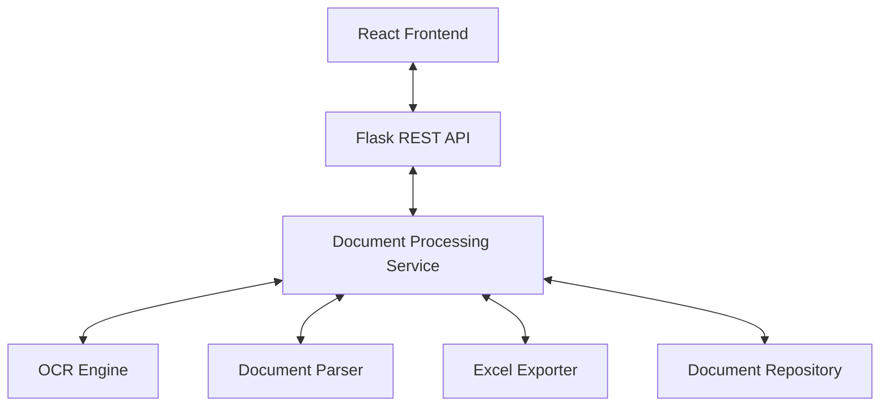

# System Architecture

The Document to Excel application is built using a decoupled Client-Server architecture.

## Overview

## Backend Modules
1. **API Layer (`app/api/`)**: Defines REST endpoints using Flask Blueprints.
2. **Service Layer (`app/services/`)**: Orchestrates the business logic flow of document ingestion, OCR, parsing, and export preparation.
3. **OCR Engine (`app/ocr/`)**: Preprocesses uploaded files and sequences them through EasyOCR, OCR.Space API, or local PaddleOCR.
4. **Document Parser (`app/parsers/`)**: Extracts details using structured regex templates or OpenRouter LLM parsing.
5. **Exporter (`app/exports/`)**: Conversions from JSON datasets into pandas DataFrames exported as Openpyxl Excel streams.
6. **Repository Layer (`app/repository/`)**: Thread-safe abstraction for persisting the latest extracted document payload in-memory.

## Frontend Modules
1. **Layouts (`components/layout/`)**: Top level app header, hero section, and stats footer.
2. **Document Panels (`components/document/`)**: Upload dropzones, preview display, debug console logs, and AG Grid editors.
3. **Custom Hooks (`hooks/`)**: Separate file previews and backend synchronization logic from UI components.
4. **API Service (`services/`)**: Centralized fetch handlers communicating with Flask backends.
